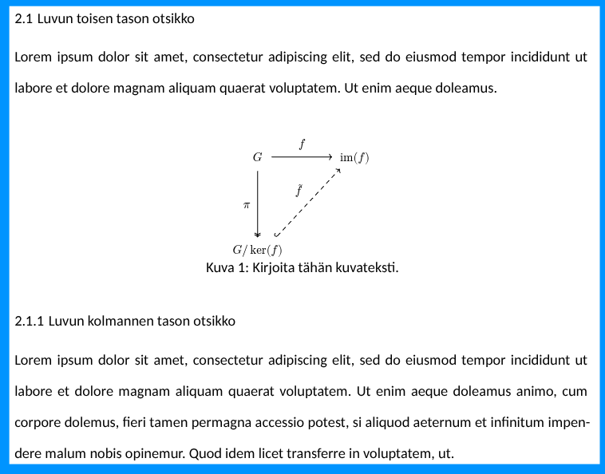

# Typst-lisäosien käyttö

Tämä ohje on kesken. Sen sisällöksi tulee pikaohje siihen, kuinka käyttää hyödyllisimpiä Typst-lisäosia, kuten Fletcher. Näiden avulla saat luotua kaavioita, taulukoita ja muuta hyödyllistä sisältöä. Lisäosia ei ole ujutettu mallipohjaan, eikä tulla koskaan ujuttamaankaan, koska ne ovat selkeästi sisältöä eivätkä osa mallipohjaa. Sinun tehtäväsi on lisätä import-lauseke; Typst lataa lisäosan automaattisesti, kun se on importattu.

## Fletcher

- <https://typst.app/universe/package/fletcher/> - Lisäosan sivu Typst-sivustolla

On suositeltavaa luoda uusi tiedosto, kuten `diagrams/esimerkki.typ` ja kirjoittaa siihen kaavio. Näin varsinainen `chapters/luku-jota-kirjoitat.typ` pysyy siistinä.

Tiedoston sisältö voi olla esimerkiksi

``` typst title="diagrams/esimerkki.typ"
// Tarkista tuorein versio dokumentaatiosta kirjoitushetkellä. Käytä mieluiten sitä!
#import "@preview/fletcher:0.5.8" as fletcher: diagram, node, edge

#figure(
    #text(size: 9pt)[
        // Note! This example has been copied from Fletcher documentation as-is!
        // the author of this repository takes no credit for the content of this example.
        #diagram(
            node-stroke: 1pt,
            node((0,0), [Start], corner-radius: 2pt, extrude: (0, 3)),
            edge("-|>"),
            node((0,1), align(center)[
                Hey, wait,\ this flowchart\ is a trap!
            ], shape: diamond),
            edge("d,r,u,l", "-|>", [Yes], label-pos: 0.1)
        )
    ],
    caption: [Kirjoita tähän kuvateksti.],
) <fig:jokin-kiva-label-kuvaajalle>
```

Tämän jälkeen voit tuoda sen päädokumenttiin seuraavasti siihen kohtaan, mihin sen haluat:

``` typst title="chapters/luku-jota-kirjoitat.typ"
// ... muu sisältö ...

#include "../diagrams/esimerkki.typ"

// ... muu sisältö jatkuu ...
```

Kun kuva on upotettuna tekstin sekaan, se näyttäytyy tavallisena kuvana ja saa tavallisen kuvan juoksevan numeroinnin. Viittaa kuvalle antamaasi nimiöön (tässä tapauksessa `fig:jokin-kiva-label-kuvaajalle`) käyttämällä `#ref`-komentoa.



**Kuva 1:** _Esimerkki._

!!! tip

    Tekoälyt, kuten Gemini tai Claude, ovat yllättävän taitavia luomaan kaavioita. Voit piirtää MS Paintissa, MkDocsissa tai jopa paperille hahmotelman kaaviosta ja pyytää kielimallia luomaan siitä Typst-koodin. Tämän jälkeen voit hienosäätää kaaviota Typst-koodissa.

## lilaq

- <https://typst.app/universe/package/lilaq/> - Lisäosan sivu Typst-sivustolla
- <https://lilaq.org/docs/quickstart> - Lisäosan dokumentaatio

Lisäosa on itsessään niin hyvin dokumentoitu, että pärjäät varmasti sen ohjeilla. Aivan kuten Fletcherin kanssa, myös tämän kanssa suositeltavaa luoda uusi tiedosto, kuten `diagrams/esimerkki-lilaq.typ` ja kirjoittaa siihen kaavio. Näin varsinainen `chapters/luku-jota-kirjoitat.typ` pysyy siistinä.

Vinkkinä kannattaa tutustua [Data loading](https://lilaq.org/docs/tutorials/data-loading)-tutoriaaliin. Tulet huomaamaan, että voit tuoda dataa esimerkiksi JSON-tiedostoista. Voit jopa luoda apufunktion, jonka avulla saat ==useita eri== kuvaajia opinnäytetyössäsi luotua yhden koodin avulla, pelkästään syöttämällä eri datatiedoston. Teeppä sama jotenkin Wordissä!
